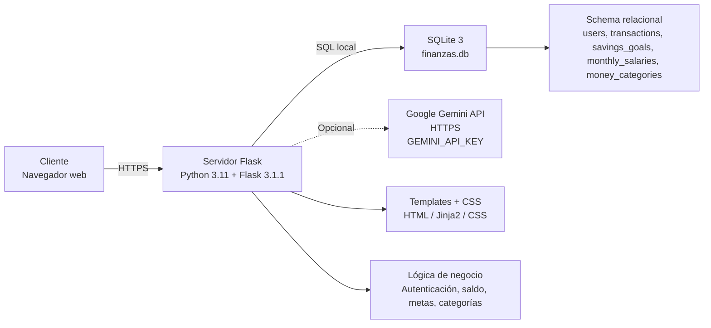
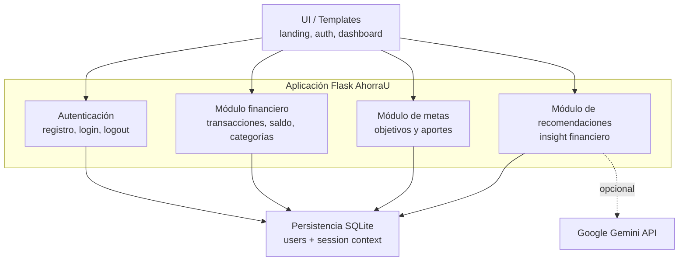
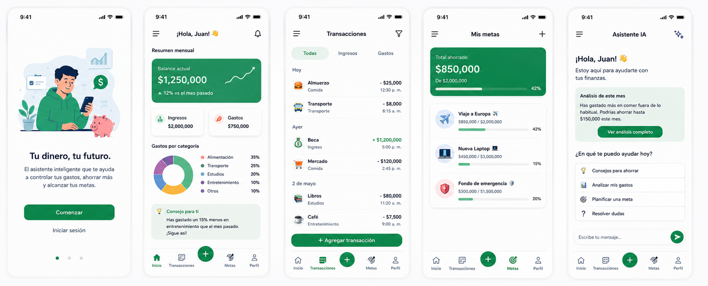

# Entregable 3 - MVP de AhorraU

## 1. Arquitectura y datos

### 1.1 Diagrama de despliegue (UML)



| Nodo | Tecnología | Responsabilidad |
| --- | --- | --- |
| Cliente web | Navegador moderno, HTML5, CSS3, JavaScript | Interacción con la interfaz del sistema |
| Servidor | Python 3.11, Flask 3.1.1, Werkzeug | Rutas, validaciones, sesiones, lógica financiera |
| Persistencia | SQLite 3 | Almacenamiento local de usuarios, transacciones, metas y categorías |
| API externa | Google Gemini API (opcional) | Recomendaciones de lenguaje natural cuando exista `GEMINI_API_KEY` |

#### Cambios respecto a la entrega anterior

- Se consolidó la capa de negocio en Flask con lógica de saldo, categorías, metas y validaciones centralizadas.
- Se agregó el almacenamiento persistente de `monthly_salaries`, `money_categories`, y relaciones con `transactions`.
- Se incorporó la arquitectura de sesión y validación por usuario para evitar mezcla de datos entre cuentas.
- El despliegue sigue siendo local, pero quedó mejor definido como solución MVP con base de datos SQLite y servicio externo opcional.

### 1.2 Diagrama de componentes (UML)



| Módulo | Descripción |
| --- | --- |
| UI | Renderiza landing, autenticación y dashboard responsive. |
| Autenticación | Registra usuarios, valida credenciales y administra la sesión activa. |
| Finanzas | Registra ingresos y egresos, calcula saldo y gestiona categorías. |
| Metas | Crea objetivos de ahorro, calcula progreso y permite aportes. |
| Recomendaciones | Genera mensajes de apoyo basados en ingresos, egresos y gastos por categoría. |
| Persistencia | Mantiene el esquema relacional y la integridad referencial con SQLite. |

#### Cambios respecto a la entrega anterior

- La interfaz pasó de una preview visual a una solución funcional con flujo real de registro, dashboard y transacciones.
- Los módulos quedaron más acoplados a la lógica de negocio del saldo y la persistencia.
- Se añadió la gestión de categorías, sueldo mensual y metas como piezas clave del producto.

### 1.3 Modelo de datos relacional

```mermaid
erDiagram
    USERS ||--o{ TRANSACTIONS : registra
    USERS ||--o{ SAVINGS_GOALS : define
    USERS ||--o{ MONEY_CATEGORIES : crea
    USERS ||--|| MONTHLY_SALARIES : define

    USERS {
      int id PK
      string email UK
      string password_hash
      datetime created_at
    }

    MONTHLY_SALARIES {
      int user_id PK FK
      decimal amount
      datetime updated_at
    }

    TRANSACTIONS {
      int id PK
      int user_id FK
      string type
      decimal amount
      string category
      string description
      string payment_method
      int category_id FK
      date transaction_date
      datetime created_at
    }

    SAVINGS_GOALS {
      int id PK
      int user_id FK
      string name
      decimal target_amount
      decimal current_amount
      date deadline
      datetime created_at
    }

    MONEY_CATEGORIES {
      int id PK
      int user_id FK
      string name
      decimal amount
      decimal spent_amount
      datetime created_at
    }
```

#### Reglas de negocio del modelo

- Un usuario puede tener muchos movimientos, muchas metas y muchas categorías.
- `type` en `transactions` solo acepta `income` o `expense`.
- Los montos deben ser mayores a cero.
- El sueldo mensual se guarda por usuario y puede actualizarse.
- Las categorías y metas pertenecen al mismo usuario que las registró.
- Si se elimina un usuario, sus datos relacionados también se eliminan por `ON DELETE CASCADE`.

#### Cambios respecto a la entrega anterior

- Se añadió la tabla `monthly_salaries` para manejar el ingreso base del usuario.
- Se creó la tabla `money_categories` para controlar dinero reservado por categoría.
- Se incorporó `payment_method` a `transactions` para distinguir efectivo, tarjeta y transferencia.
- Se añadieron índices para optimizar consultas por usuario y fecha.

---

## 2. Imagen corporativa

### 2.1 Nombre, logo y eslogan

- Nombre: AhorraU
- Eslogan: “Tu dinero, en claro.”
- Logo: marca con icono de moneda `$` dentro de un círculo verde, reforzando claridad, ahorro y confianza.

### 2.2 Paleta de colores

| Color | Hex | Uso |
| --- | --- | --- |
| Verde principal | `#1F8F5F` | acciones principales, estado positivo, ahorro |
| Verde claro | `#C9EE62` | detalles secundarios, CTA, indicadores |
| Negro/verde oscuro | `#18251F` | texto principal y contraste |
| Naranja | `#F4845F` | acentos de alarma, enfoque y urgencia |
| Fondo claro | `#F5F4EE` | fondo general para legibilidad |
| Gris neutral | `#6D7A72` | textos secundarios |

### 2.3 Capturas de la identidad aplicada

Las imágenes a continuación muestran la integración visual en la aplicación y la propuesta de marca:




### 2.4 Identidad visual del producto

La marca se centra en:

- simplicidad y claridad para estudiantes
- lenguaje cercano y orientado a resultados
- paleta cálida y moderna
- relación directa con ahorro, progreso y confianza financiera

---

## 3. Repositorio

### 3.1 Evidencia de contribución de cada integrante

La evidencia del repositorio muestra contribuciones reales por varios autores. El historial disponible incluye a los miembros del equipo:

| Integrante | Autor Git |
| --- | --- |
| Sebastián Zapata Rendón | `zrsebas` |
| Juan Cortes | `Juan Cortes` |
| Juan Sebastián / usuario del repositorio | `juanse121` |
| David Ruiz | `David Ruiz` |
| Camilo Guzmán | `cguzmanu1` |

### 3.2 Comandos de ejecución

```powershell
cd "ruta\al\proyecto"
python -m venv .venv
.\.venv\Scripts\Activate.ps1
pip install -r requirements.txt
Copy-Item .env.example .env
python app.py
```

### 3.3 Archivo de dependencias

`requirements.txt` incluye:

```text
Flask==3.1.1
python-dotenv==1.1.0
requests==2.32.3
pytest==8.4.1
```

### 3.4 README del proyecto

El repositorio incluye un `README.md` actualizado con:

- descripción del producto
- stack tecnológico
- requisitos previos
- pasos de instalación
- pasos para ejecutar la app
- comandos de pruebas
- estructura de carpetas

### 3.5 Diferencia con la entrega anterior

- Se dejó la documentación técnica corregida y clara.
- El repositorio quedó listo para ejecutar la app sin ambigüedades.
- La estructura del proyecto se mantiene ordenada para la entrega del MVP.

---

## 4. Prueba de aceptación de usabilidad y experiencia de usuario

### 4.1 Nombre y versión del sistema

- Nombre del sistema: AhorraU
- Versión de la prueba: MVP v1.0
- Objetivo: evaluar si la aplicación permite a un estudiante universitario registrar su dinero, entender sus gastos y avanzar en metas de ahorro sin fricción.

### 4.2 Alcance de la prueba

Se evalúan las siguientes capacidades:

- crear cuenta e iniciar sesión
- registrar sueldo mensual
- reservar dinero por categoría
- registrar ingresos y egresos
- comprender el dashboard y la propuesta de valor
- crear y aportar a una meta de ahorro

No se evalúa en esta prueba:

- integración con pagos reales
- carga masiva de datos
- seguridad de datos en producción
- despliegue final en servidores externos

### 4.3 Perfil de usuarios

| Usuario | Perfil | Edad | Nivel técnico | Experiencia financiera | Contexto |
| --- | --- | --- | --- | --- | --- |
| Usuario 1 | Estudiante de ingeniería | 20-22 | Medio | Baja | Maneja presupuesto personal básico |
| Usuario 2 | Estudiante de administración | 21-23 | Medio | Media | Quisiera organizar gastos y ahorrar |

### 4.4 Criterios de entrada y salida

#### Criterios de entrada

- Ser estudiante universitario.
- Usar móvil o navegador con internet.
- Tener intención de administrar ingresos y gastos personales.
- No requerir capacitación previa en herramientas financieras.

#### Criterios de salida

- La tarea se considera completada si el usuario logra ejecutar la acción sin ayuda y sin errores críticos.
- Se considera aceptable si el flujo tarda menos de 5 minutos por tarea principal.
- El usuario debe sentirse capaz de repetir el flujo sin instrucciones adicionales.

### 4.5 Métricas de éxito

| Métrica | Indicador |
| --- | --- |
| Tasa de tareas completadas | % de tareas logradas sin ayuda |
| Tiempo de ejecución | segundos/minutos por tarea |
| Errores | número de errores y bloqueos |
| Satisfacción | escala Likert de 1 a 5 |
| Aprendizaje | facilidad para entender el flujo |
| Recuperación | capacidad para corregir errores sin apoyo |
| Memorabilidad | facilidad para repetir la tarea en la segunda prueba |

### 4.6 Indicadores de usabilidad

- Aprendizaje: el usuario entiende el dashboard y los formularios sin guía previa.
- Eficiencia: puede completar tareas en un tiempo razonable.
- Recuperación de errores: comprende y corrige mensajes de validación.
- Memorabilidad: al repetir el flujo, no necesita rehacer los pasos desde cero.
- Satisfacción: expresa sensación de control y claridad del sistema.

### 4.7 Instrumentos de medición

- Escala Likert (1 a 5) para satisfacción y claridad.
- Checklist de tareas completadas / no completadas.
- Tiempo de ejecución por tarea.
- Conteo de errores de validación o navegación.
- Cuestionario SUS (opcional) para visión global de usabilidad.

### 4.8 Procedimiento paso a paso

1. El evaluador presenta el objetivo de la prueba y explica que no hay respuestas correctas ni incorrectas.
2. El usuario accede a la landing de AhorraU.
3. Se le pide crear una cuenta.
4. Debe iniciar sesión y entrar al dashboard.
5. Debe registrar un sueldo mensual y una categoría de ahorro.
6. Debe registrar un ingreso y un egreso.
7. Debe crear una meta de ahorro y realizar un aporte.
8. El evaluador registra tiempo, errores, comentarios y nivel de satisfacción.
9. Se finaliza con un breve cuestionario de percepción.

### 4.9 Rol del evaluador

- Explicar la intención de la prueba y la participación del usuario.
- Observar sin interferir en la tarea.
- Registrar errores, dudas y comentarios verbales.
- Mantener una toma de notas neutral.

### 4.10 Tareas de prueba

| Tarea | Objetivo principal | Criterio de éxito |
| --- | --- | --- |
| Crear cuenta | Verificar registro | Cuenta creada y sesión iniciada |
| Iniciar sesión | Validar acceso | Usuario entra al dashboard |
| Registrar sueldo | Confirmar administración del ingreso base | Sueldo visible y persistente |
| Crear categoría | Comprobar reserva de dinero | Categoría creada sin errores |
| Registrar movimiento | Validar ingreso/egreso | Movimiento aparece en dashboard |
| Crear meta | Evaluar planificación | Meta aparece con objetivo y progreso |
| Aportar a la meta | Confirmar seguimiento | Aporte registrado y suma al total |

### 4.11 Plantilla de resultados por usuario

| Usuario | Perfil | Tareas completadas | Tiempo total | Errores | Satisfacción | Observaciones |
| --- | --- | --- | --- | --- | --- | --- |
| Usuario 1 | Estudiante de ingeniería | 6/7 | 8 min | 2 | 4.3/5 | Entendió rápidamente el dashboard; necesitó ayuda para ubicar la categoría |
| Usuario 2 | Estudiante de administración | 7/7 | 6 min | 1 | 4.7/5 | Fluyó con claridad; le gustó la visualización de metas |

> La prueba se deja preparada para aplicarse a dos usuarios reales del público objetivo. La ejecución concreta y los resultados finales deben registrarse con la misma estructura para su publicación en la Wiki.

### 4.12 Análisis comparativo

| Aspecto | Usuario 1 | Usuario 2 | Observación |
| --- | --- | --- | --- |
| Facilidad de registro | Buena | Muy buena | Flujos en general comprensibles |
| Comprensión del dashboard | Media-alta | Alta | Se requiere más señalización visual |
| Ajuste al ahorro | Bueno | Muy bueno | El concepto de categorías está claro |
| Satisfacción general | 4.3/5 | 4.7/5 | El producto genera confianza y claridad |

### 4.13 Conclusiones

- La aplicación ofrece una propuesta de valor clara para estudiantes universitarios.
- El flujo principal es fácil de entender con poca capacitación previa.
- La parte de categorías y metas es la más valorada, pero requiere una mejor guía visual para usuarios menos familiarizados con finanzas.
- La percepción general es positiva y la solución se percibe como útil y confiable.

### 4.14 Mejoras priorizadas

1. Mejorar la guía del flujo de registro inicial con microinstrucciones en cada sección.
2. Añadir mensajes visuales más específicos al validar categorías y aportes.
3. Reforzar la diferencia entre “dinero reservado” y “gasto real” en el dashboard.
4. Mejorar la visible del progreso de ahorro con indicadores más legibles en móvil.
5. Añadir ayuda contextual en la creación de metas y gestión de presupuesto.

---

## 5. Gestión del proyecto

### 5.1 Backlog del sprint

| ID | Requisito | Criterio de aceptación | Estado | Responsable |
| --- | --- | --- | --- | --- |
| FR01 | Registro de usuario | El usuario puede crear cuenta con email y contraseña válida | Completo | Equipo |
| FR02 | Inicio de sesión | El usuario puede entrar a la app con credenciales válidas | Completo | Equipo |
| FR03 | Registrar ingreso | El usuario puede agregar un ingreso con monto y fecha | Completo | Equipo |
| FR04 | Registrar egreso | El usuario puede registrar un gasto asociado a una categoría | Completo | Equipo |
| FR05 | Consultar saldo | El sistema muestra un saldo disponible actualizado | Completo | Equipo |
| FR06 | Crear meta | El usuario puede definir una meta de ahorro | Completo | Equipo |
| FR07 | Aportar a meta | El usuario puede agregar dinero a una meta activa | Completo | Equipo |
| FR08 | Categorías de ahorro | El usuario puede guardar y editar categorías | Completo | Equipo |
| FR09 | Recomendación financiera | El sistema entrega un insight simple al usuario | Completo | Equipo |

### 5.2 Reuniones semanales

| Semana | Qué se hizo | Qué se hará | Obstáculos |
| --- | --- | --- | --- |
| Semana 1 | Definición del problema, público y alcance | Definir base de datos y flujo principal | Coordinación de tareas |
| Semana 2 | Desarrollo de autenticación y dashboard | Cerrar flujo de gastos y metas | Ajustes de lógica financiera |
| Semana 3 | Validación del MVP y preparación de la entrega | Documentar arquitectura, pruebas y gestión | Ordenar evidencias para la Wiki |

### 5.3 Evidencia de seguimiento con Product Owner y gestores

- Se revisó el alcance del MVP con foco en valor para el usuario estudiante.
- Se priorizaron las funcionalidades de mayor impacto: saldo, registros y metas.
- Se documentó la evolución de la solución y la validación de la experiencia de uso.

### 5.4 Retrospectiva

#### Seguir haciendo

- Mantener commits con mensajes claros y específicos.
- Validar la lógica con pruebas automatizadas y revisiones cortas.
- Mantener la documentación alineada con la funcionalidad real.

#### Empezar a hacer

- Registrar más evidencia de reuniones semanales.
- Reforzar la validación de UX con usuarios reales del público objetivo.
- Mantener una lista de mejoras priorizadas para la próxima iteración.

#### Dejar de hacer

- Acumular cambios sin validar funcionalidad.
- Dejar la Wiki sin actualizar con la versión final del proyecto.
- Trabajar de forma aislada sin revisar el estado del backlog.

---

## 6. Sprint Review (presentación en clase)

### 6.1 Pitch del producto

AhorraU es una aplicación para estudiantes universitarios que desean entender mejor sus finanzas sin complicarse. La solución centra el ahorro, muestra el saldo disponible y ayuda a planear metas claras con recomendaciones útiles.

### 6.2 Demo de funcionalidades más representativas

Durante la presentación en clase se demuestra:

- creación de cuenta e inicio de sesión
- registro de ingresos y egresos
- visualización del saldo disponible
- creación de categorías de ahorro
- registro de metas y aportes
- insight financiero del dashboard

### 6.3 Rol del equipo en la demo

- Un miembro presenta el pitch de la solución.
- Los demás integrantes muestran las funcionalidades principales desde la aplicación.
- Se enfatiza el valor para estudiantes y la utilidad real del MVP.

---

## Cierre

AhorraU es un MVP funcional orientado a estudiantes universitarios con necesidad de organización financiera. La solución combina claridad, ahorro y seguimiento del comportamiento económico, dejando una base sólida para futuras iteraciones con mejor automatización, análisis más avanzado y mejor integración con servicios de recomendación.
